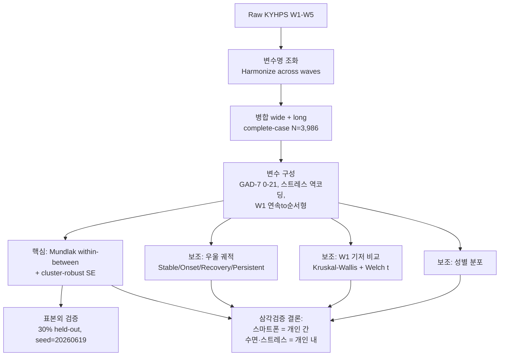

# Between-Person Risk vs. Within-Person Change in Adolescent Anxiety
### 청소년 스마트폰 이용과 불안: KYHPS 5개년 패널의 개인 간·개인 내 효과 분리 (Mundlak 모형)


<p align="center">
  <br>
  <sub><b>Figure 1.</b> GAD-7 불안 요인의 개인 간·개인 내 효과 분해(Mundlak 모형). A는 변수별 개인 내 효과와 개인 간 효과의 계수와 95% CI. 스마트폰은 개인 간 효과만 유의(β=+0.113, p=.002), 개인 내는 비유의(β=+0.023, p=.454). 수면·스트레스는 양쪽 유의. B는 개인 간 효과를 1로 둔 개인 내 효과의 상대 크기를 불안·우울 결과에서 비교.</sub>
</p>

> **데이터 미포함.** KYHPS 원자료·가공자료는 승인 기반 제한자료로 **재배포가 금지**되어 이 저장소에는 포함하지 않습니다. 코드·문서·그림·결과표만 공개합니다. → [`data/README.md`](data/README.md)

---

## 요약

**질문.** 청소년에서 흔히 보고되는 "스마트폰–불안" 연관은
*누가 더 불안한가(**between-person**)* 의 문제인가, *같은 학생이 더 많이 쓰는 시기에 더 불안해지는가(**within-person**)* 의 문제인가?
단면조사로는 구분되지 않는 이 둘을, 같은 청소년 **3,986명**을 5년간 추적한 패널자료로 분리했다.

**핵심 발견.**
- **스마트폰**은 anxiety의 **개인 간(between) 연관에만 유의** (β = +0.113, *p* = .002) — 개인 내(within)는 유의하지 않음 (β = +0.023, *p* = .454).
-  **수면·스트레스**가 개인 내(within) 변화 신호를 담당 (within이 가장 큰 영역: 가족 스트레스 β = +0.607).
-  W1 우울자 692명 중 **476명(68.8%)이 회복** — 회복은 예외가 아니라 주요 경로.

**내 역할.** 5인 팀의 **제1저자·발표자**. 데이터 파이프라인 구축, Mundlak 모형(개인 군집강건 SE) 직접 구현, 표본외 검증, Figure·원고 작성을 **단독 담당**.

**방법.** KYHPS 2019–2023 (W1–W5) · **Mundlak within–between decomposition** + person cluster-robust SE · 30% held-out 표본외 검증 · Python 3.11.

<sub>목차: [질문](#연구-질문) · [데이터와 변수](#데이터와-변수) · [방법론](#방법론) · [결과](#주요-결과) · [그림](#그림) · [내 기여](#내-기여) · [강건성·한계·재현](#강건성한계재현) · [구조](#저장소-구조)</sub>

---

## 연구 질문

청소년 정신건강 감시체계(예: 청소년건강행태조사)는 대부분 **단면조사**여서, 매년 다른 학생을 측정한다. 따라서 같은 학생의 불안이 악화·회복되는 과정을 포착하지 못한다. 이 프로젝트는 같은 청소년을 5년간 추적한 **KYHPS** 패널로, 단면조사가 답할 수 없는 질문을 던진다.

> **개인 간** — "스마트폰을 많이 쓰는 학생이 더 불안한 학생인가?"
> **개인 내** — "같은 학생이 더 많이 쓰는 시기에 더 불안해지는가?"

이 둘은 **다른 정책**을 함의한다(위험군 선별 vs. 악화 추적). 패널자료는 한 모형에서 둘을 동시에 추정할 수 있다.

**보조 질문**
- 새로 우울이 생긴(Onset) 청소년을 W1 시점에 미리 가른 baseline 지표는?
- 변화 구간(W3→W5)에서 불안과 함께 움직인 변수는?
- 궤적 위험은 성별로 어떻게 분포하는가?

---

## 데이터 & 변수

| 항목 | 내용 |
|---|---|
| 자료원 | Korean Youth Health Panel Survey (KYHPS) |
| 차수 | W1–W5, 연 1회, **2019–2023** |
| 설계 | 같은 개인을 반복측정하는 전향적 패널 |
| 분석표본 | **5개 차수 모두 응답한 3,986명** (complete-case) |
| 성별 | 남 2,099 / 여 1,887 |
| 분석단위 | 패널모형 = person × wave (long) / 궤적분류 = person (wide) |

| 변수 | 코딩 | 차수 | 비고 |
|---|---|---|---|
| **GAD-7 불안** (주 결과) | 0–21 연속, ≥10 = 중등도↑ | **W3–W5** | 표준 0–21로 교정 |
| **우울** (단일문항) | 1=없음, 2=있음 | W1–W5 | 자기보고, 궤적분류 기준 |
| **주중 수면** | 1–8 순서형 | W1–W5 | W1 연속 → W2+ 척도로 구간매핑 |
| **주중 스마트폰 이용** | 1–9 순서형 | W1–W5 | W1 연속 → W2+ 척도로 구간매핑 |
| **스트레스** (5영역) | 역코딩(값↑=스트레스↑) | W1–W5 | 학업·미래·친구·외모·가족 |
| 성별 · 조사차수(연도) | — | W1–W5 | Mundlak 모형 공변량 (성별은 층화에도 사용) |

> **측정 주의(전체에 적용):** 스마트폰·수면 척도가 W1(연속)과 W2+(순서형)에서 달라 W1을 구간매핑했다. GAD-7은 **W3–W5 세 시점뿐**이며, 이는 개인 내 불안 결과의 해석 범위를 의도적으로 제한한다.

---

## 기술 스택

| 구분 | 도구 |
|---|---|
| 언어 | Python 3.11 |
| 데이터 처리 | pandas · numpy |
| 통계·검정 | scipy (Kruskal–Wallis · Welch t · χ²) |
| 패널·회귀 | statsmodels · linearmodels (OLS/FE/RE · Hausman · Mundlak LPM) |
| 시각화 | matplotlib |

> 전체 의존성: [`requirements.txt`](requirements.txt).

---

## 방법론



**왜 between/within 분리가 중요한가.** 1년 스냅샷에서는 똑같아 보이는 두 사실이 있다. **사실 A**: 폰을 많이 쓰는 학생이 평균적으로 더 불안한 학생이다(개인 간). **사실 B**: 어떤 학생이 폰을 더 많이 쓰는 *시기*에 더 불안해진다(개인 내). 단면조사는 둘을 구분 못 하지만, 함의하는 정책은 다르다(위험군 선별 vs. 악화 추적). Mundlak 모형은 각 변수를 **개인평균(between)** 과 **개인 내 편차(within)** 로 쪼개 한 모형에 동시 투입함으로써 둘을 분리한다.

<details>
<summary><b>통계 모형 상세 — 펼치기</b></summary>

<br>

**① Mundlak 분해 — 핵심 모형.** 각 시간가변 공변량 `x_it`를 개인평균(between)과 개인 내 편차(within)로 분해해 동시 투입:

```
GAD7_it = β0 + β_within·(x_it − x̄_i) + β_between·x̄_i + ε_it
```
- **추정량:** 선형확률/OLS 패널모형(LPM). 각 시간가변 공변량을 개인평균·개인 내 편차로 분해해 동시 투입하고, **person(pid) 군집강건 SE를 numpy로 직접 구현**했다 — 구현체는 [`scripts/depression_panel_v2.py`](scripts/depression_panel_v2.py)의 `mundlak()`. 공변량으로 **성별·조사차수(연도)** 포함.
- `β_between` = "어떤 청소년이 더 불안한가", `β_within` = "같은 청소년이 어느 시기에 더 불안한가".
- **표본외 검증:** 30% held-out(seed 20260619)로 between-only vs. within+between의 예측 R² 비교.

**② 우울 궤적 분류 — 보조.** W1·W5 우울 경험 여부로 4분류:

| 그룹 | W1 | W5 |
|---|---|---|
| Stable | 비우울 | 비우울 |
| Onset | 비우울 | 우울 |
| Recovery | 우울 | 비우울 |
| Persistent | 우울 | 우울 |

**③ 기저·변화 비교 — 보조.** 4군 omnibus: Kruskal–Wallis / Onset vs. Stable: Welch t / W3→W5 변화 집단별 확인.
**④ 성별 — 보조.** 성별 × 궤적 (χ²).

**⑤ 강건성 모형 — 보조.** FE / RE / Hausman / logit AME / CCA·LOCF·MICE 비교는 [`scripts/panel_ols.py`](scripts/panel_ols.py)·[`scripts/robustness_check.py`](scripts/robustness_check.py)에서 statsmodels·linearmodels로 추정 → `results/tables/robustness_*.xlsx`.

전 분석 **Python 3.11** (pandas, numpy, scipy, statsmodels, linearmodels), 양측 α = 0.05. 스크립트별 산출표 매핑: [`scripts/README.md`](scripts/README.md).

</details>

---

## 설계 의사결정

> 핵심은 수치가 아니라 "왜 그렇게 결정했는가". 각 결정은 저장소의 코드·산출물로 추적된다.

| 결정 | 이유 |
|---|---|
| 추정량으로 **선형확률/OLS Mundlak** 채택 | within/between 계수를 같은 척도로 직접 비교·해석하기 위해. 우울(0/1) 결과도 로짓 대신 LPM으로 통일해 within/between 스케일 일치 |
| **person 군집강건 SE를 직접 구현** | 반복측정(같은 개인 3회)의 오차 상관 보정 — `scripts/depression_panel_v2.py`의 `mundlak()` |
| **complete-case(N=3,986) 주분석 + CCA/LOCF/MICE 민감도** | 탈락 편향을 무시하지 않되 주분석은 단순·투명하게. 대안 처리와의 민감도는 `robustness_mice_vs_cca.xlsx`로 커밋 |
| 핵심 모형은 `scripts/`, `src/`는 intake·전처리 | 재현 파이프라인과 분석 실행을 분리 (→ [`src/README.md`](src/README.md) · [`scripts/README.md`](scripts/README.md)) |
| 스마트폰 within 비유의를 **"창 의존적"으로 해석** (무효과 증명 아님) | 더 긴 우울 창(W1–W5)에서는 within이 유의 → 짧은 GAD-7 창(W3–W5)에 한정된 잠정 결론 |

---

## 주요 결과

> 모두 **관찰 패널 내 연관(association)** 이며 인과가 아니다. within 계수는 **동시측정(same-wave)** 연관으로 시간선후를 보장하지 않는다.

**표1. 우울 궤적별 W1 기저 평균 (N = 3,986).** 스트레스 역코딩(†값↑=스트레스↑). p = Kruskal–Wallis 4군 omnibus.

| W1 기저 | Stable | Onset | Recovery | Persistent | p |
|---|---:|---:|---:|---:|---:|
| 수면시간 (1–8) | 6.08 | 5.90 | 5.79 | 5.70 | <.001 |
| 스마트폰 이용 (1–9) | 4.15 | 4.31 | 4.62 | 4.61 | <.001 |
| 학업 스트레스† | 1.96 | 2.13 | 2.56 | 2.46 | <.001 |
| 미래 스트레스† | 1.68 | 1.86 | 2.21 | 2.29 | <.001 |
| 외모 스트레스† | 1.54 | 1.68 | 2.09 | 2.23 | <.001 |

**핵심 해석:** 스마트폰의 omnibus 유의는 **이미 W1에 우울했던 Recovery/Persistent(4.62/4.61)** 의 높은 이용에서 비롯 — 즉 우울에 동반되는 **개인 간** 특성이지 발생을 예고한 차이가 아니다. Onset과 Stable은 W1 스마트폰 이용이 **다르지 않았고**(Welch p = .086), Onset은 대신 수면이 짧고 학업·미래·외모 스트레스가 높았다.

**표2. 궤적 집단 규모.**

| 그룹 | N | % |
|---|---:|---:|
| Stable | 2,795 | 70.1 |
| Onset | 499 | 12.5 |
| Recovery | 476 | 11.9 |
| Persistent | 216 | 5.4 |

**Mundlak 계수 (GAD-7, W3–W5), 일부.** 전체: [`results/tables/dep_v2_mundlak_gad7.xlsx`](results/tables/dep_v2_mundlak_gad7.xlsx)

| 공변량 | Within β (p) | Between β (p) |
|---|---|---|
| 스마트폰 이용 | +0.023 (.454, n.s.) | +0.113 (.002) |
| 가족 스트레스 | +0.607 (유의) | 유의 |
| 친구 스트레스 | +0.571 (유의) | 유의 |
| 수면 | 유의 | 유의 |

**표본외(30% held-out) test R²:** between-only **0.125 → 0.206** within+between ([`dep_v2_oos.xlsx`](results/tables/dep_v2_oos.xlsx)).

**그 외 결과 한 줄 요약**
- **창(window) 의존성:** 더 긴 우울 결과(W1–W5)에서는 스마트폰 within이 유의 → 불안에서의 within 비유의는 짧은 GAD-7 구간(W3–W5)에 한정된 잠정 결론(무효과 증명 아님).
- **중등도 불안(GAD-7≥10):** Onset/Persistent ≈ 24% vs. Stable/Recovery ≈ 4% (약 6배).
- **성별:** 여학생 비율 Stable 43.9% → Persistent 69.0% (p < .001), 우울 전환율 여 17.6% vs. 남 13.1%.

---

## 그림

| 파일 | 내용 |
|---|---|
| [`fig1_within_between.png`](figures/fig1_within_between.png) | GAD-7 불안 요인의 개인 간·개인 내 효과 분해(Mundlak 모형). A는 변수별 개인 내·개인 간 계수와 95% CI — 스마트폰은 **개인 간만 유의**. B는 개인 간 효과를 1로 둔 개인 내 효과의 상대 크기를 불안·우울 결과에서 비교 |
| [`fig2_depression_trajectories.png`](figures/fig2_depression_trajectories.png) | 5개년 우울 궤적과 불안 결과 — 차수별 우울 경험 비율, 집단별 W5 GAD-7 평균·중등도(≥10) 비율 |
| [`fig3_change_trajectories.png`](figures/fig3_change_trajectories.png) | 우울 궤적 집단별 W3~W5 변화 궤적 (A 불안 B 미래 C 가족 스트레스 D 수면). Onset은 불안·미래·가족 모두 상승, Recovery는 불안·**가족**만 하강. 미래 스트레스는 전 집단 상승, 수면은 전 집단 감소(코호트 추세), **가족 스트레스만 궤적 방향과 동행** |
| [`figures/eda/`](figures/eda) | 선별 탐색 그림 (성별 하위그룹, key paradox, onset vs. stable) |

---

## 내 기여

> 5인 팀 공모전 제출작. 각 항목은 저장소의 코드·산출물과 연결된다.

**역할:** 제1저자 · 데이터 분석 담당.

| 영역 | README/CV에 쓸 수 있는 표현 | 설명 가능한 내용 |
|---|---|---|
| 연구 설계 | 단면 질문을 within–between 패널 질문으로 재정의 | between vs. within이 왜 다른 질문인지, 왜 패널이 필요한지 |
| 데이터 엔지니어링 | W1–W5 조화→병합→추적→정제 파이프라인 구축 (`src/01`–`05`) | W1 연속 vs. W2+ 순서형 척도 문제와 해결, CCA/LOCF/MICE 트레이드오프 |
| 모델링 | Mundlak 분해 + person cluster-robust SE 직접 구현 (`scripts/depression_panel_v2.py`) | within/between 분해의 의미, 반복측정에서 군집강건 SE가 필요한 이유 |
| 검증 | 표본외 검증·결과창 강건성 비교 추가 | 스마트폰 within 비유의를 왜 "창 의존적"으로 해석하는지 |
| 전달 | 최종 Figure·원고 작성 | 삼각검증 논리와 한계 |

**정직한 경계:** 어떤 결과도 인과로 표현하지 않음 · within 계수는 동시측정 연관 · 팀 제출작의 분석 리드이지 모든 구성요소의 단독 저자가 아님 · 스마트폰 within 비유의를 "효과 없음의 증명"으로 제시하지 않음.

---

## Key Takeaway

같은 1년 스냅샷에서 똑같아 보이는 "스마트폰–불안"이, 같은 청소년을 5년 추적하자 **개인 간(누가 더 불안한가)** 신호였지 **개인 내(같은 학생이 더 불안해지는가)** 신호는 아니었다(짧은 GAD-7 창 기준). 개인 내 변화를 끌고 간 것은 **수면·스트레스**였고, W1 우울자의 **68.8%가 회복**했다. 핵심은 청소년 정신건강에서 위험군 선별과 악화 추적이 **서로 다른 문제**이며, 단면조사로는 이 둘을 가를 수 없다는 점이다.

---

## 강건성 · 한계 · 재현

<details>
<summary><b>강건성 검정</b></summary>

<br>

> 원고에는 **표본외 검증**과 **결과창 비교**를 수록. 나머지는 4쪽 원고를 넘어선 **저장소 수준 민감도분석**(결과표로 커밋).

| 검정 | 무엇을 보는가 | 결과 | 산출물 |
|---|---|---|---|
| 표본외 검증 | 과적합 | within 정보가 held-out R² 향상 | `dep_v2_oos.xlsx`, `rec_oos_validation.xlsx` |
| 결과창 비교 | within 비유의가 창 특이적인가 | 긴 우울 창에서는 유의 | `dep_v2_mundlak_dep_5wave.xlsx`, `dep_v2_mundlak_dep_w35.xlsx` |
| 측정 강건성 | W1 연속→순서형 매핑 민감도 | 조화 선택에 대해 점검 | `rec_measurement_quality.xlsx`, `rec_rtm_audit.xlsx` |
| 결측 처리 | CCA vs. LOCF vs. MICE | complete-case를 넘어선 민감도 | `robustness_mice_vs_cca.xlsx` |
| 모형 비교 | FE / RE / Hausman / logit AME | 추정량 민감도 | `robustness_*.xlsx`, `panel_*_coefficients.xlsx` |

</details>

<details>
<summary><b>한계</b></summary>

<br>

1. **선택/탈락** — 5차 완전응답자(N=3,986)만 분석. 탈락자가 더 취약했다면 연관은 보수적으로 추정됐을 수 있음.
2. **짧은 불안 창** — GAD-7이 W3–W5뿐이라 within 시간폭이 좁음.
3. **자기보고 우울** — 궤적은 단일문항 이분화(임상진단 아님, 단 GAD-7과 일관).
4. **동시측정 within** — same-wave 연관으로 ΔX가 ΔY에 선행함을 보이지 못함. 수면이 전 집단 공통 감소라 within 수면–불안에 연령·시기 효과가 섞일 수 있음.
5. **단일 코호트, 핵심모형 가중치 미적용** — 설계기반 추론·광범위 일반화는 주장 안 함.
6. **척도 조화** — W1 스마트폰·수면을 연속→순서형 매핑 → W1→W2 변화 해석 제약.

</details>

<details>
<summary><b>향후 과제·재현</b></summary>

<br>

**향후:** lagged/cross-lagged(RI-CLPM)로 시간선후 보강 · 수면–불안 사이 스트레스의 종단 매개 · 탈락 모델링(IPW/FIML) · KYHPS 가중치·층화·군집 기반 설계추론 · 성별 층화 Mundlak.

**재현:**
```bash
python -m venv .venv && source .venv/bin/activate   # Python 3.11
pip install -r requirements.txt
# data/raw/ 에 제한자료를 직접 배치한 뒤:
python scripts/depression_panel_v2.py   # 핵심 Mundlak → results/tables/dep_v2_*.xlsx
python scripts/onset_analysis.py
python scripts/recovery_redesign.py
python scripts/figure3_final.py
```
모든 train/test split seed = **20260619**. 전체 단계: [`docs/reproduce.md`](docs/reproduce.md).

</details>

---

## 저장소 구조

```
kyhps-anxiety-dynamics/
├── README.md
├── LICENSE                     # 코드 MIT / 데이터 재배포 불가
├── requirements.txt
├── manuscript/                 # 최종 공모전 원고 (PDF)
├── figures/                    # Figure1–3 (+ eda/)
├── scripts/                    # 분석·그림 스크립트 (depression_panel_v2.py = 핵심) → scripts/README.md
├── results/tables/             # 모형 산출표 (dep_v2_*, rec_*, robustness_* ...)
├── src/                        # 번호순 재현 파이프라인 (00_config–08_visualization) → src/README.md
├── notebooks/                  # 탐색 EDA (EXP002–004)
├── docs/                       # codebook · methods · reproduce.md
└── data/                       # README만 — 제한자료 미포함
```

---

## 참고문헌

1. Mundlak Y. On the pooling of time series and cross section data. *Econometrica.* 1978;46(1):69–85.
2. Orben A, Przybylski AK. The association between adolescent well-being and digital technology use. *Nat Hum Behav.* 2019;3(2):173–182.
3. Spitzer RL, Kroenke K, Williams JBW, Löwe B. A brief measure for assessing generalized anxiety disorder: the GAD-7. *Arch Intern Med.* 2006;166(10):1092–1097.
4. 조수경, 이소연. 청소년의 수면시간 변화궤적과 관련 요인. *한국청소년연구.* 2020;31(1):5–32.
5. 유창민. 한국 청소년의 수면시간 변화 유형 분류 및 예측요인 확인: 잠재계층성장분석을 적용한 7개년도 종단연구. *보건사회연구.* 2019;39(1):230–258.

---

1. Mundlak Y. On the pooling of time series and cross section data. Econometrica. 1978;46(1):69–85.
2. Orben A, Przybylski AK. The association between adolescent well-being and digital technology use. Nat Hum 
