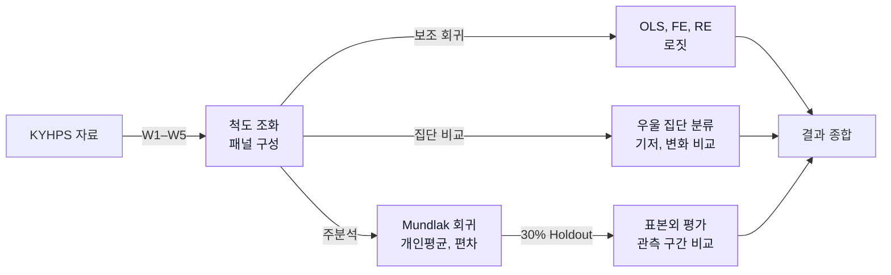
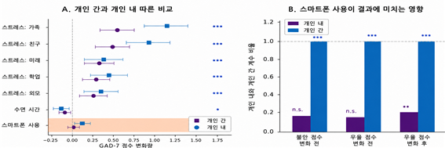
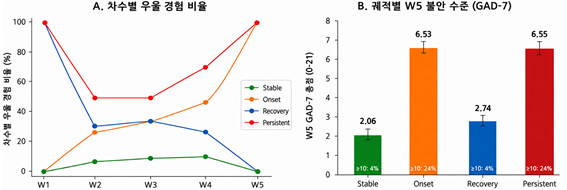
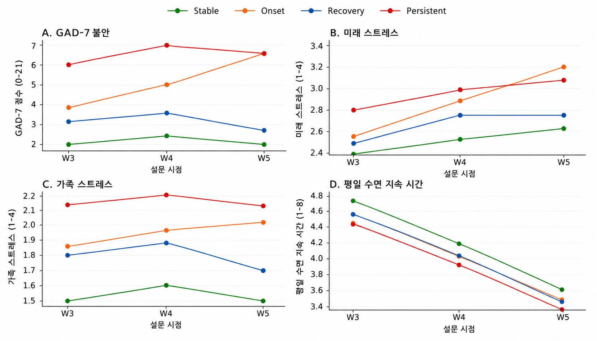

# Adolescent Anxiety and Smartphone Use

## Overview

청소년의 스마트폰 이용, 수면, 스트레스와 불안의 관계를 KYHPS 패널로 분석. **학생 간 차이**와 **같은 학생의 시기별 변화**를 분리하고, 우울 경험 변화에 따른 집단별 불안 수준 비교.

    

## Data

| Item | Details |
|---|---|
| Source | 한국청소년건강패널조사, KYHPS |
| Period | **2019–2023년, W1–W5** |
| Sample | 5개 차수 모두 응답한 **3,986명** |
| Outcome | **GAD-7 불안 점수 0–21**, W3–W5에서 측정 |
| Variables | 스마트폰 이용, 수면, 스트레스, 우울 경험, 성별, 조사차수 |
| Access | 승인 기반 제한자료, 원자료와 개인 단위 가공자료 미공개 |

## Research Design

1. **조사차수별 변수 통합**

   - W1–W5 변수명을 맞추고 개인별 반복측정 자료 구성
   - W1의 스마트폰, 수면 연속값을 이후 차수의 순서형 척도에 맞춰 구간 매핑
   - GAD-7을 **0–21점**으로 구성하고 스트레스는 높을수록 스트레스가 큰 방향으로 역코딩

2. **우울 경험 변화로 집단 분류**

   - W1과 W5의 우울 경험 여부로 **비우울 유지, 신규 발생, 회복, 지속** 집단 분류
   - 집단별 기저 특성과 W3–W5 불안, 수면, 스트레스 변화 비교

3. **Mundlak 회귀분석으로 개인 간, 개인 내 관계 분리**

   - 스마트폰, 수면, 스트레스를 **개인평균**과 **개인평균에서 벗어난 시기별 편차**로 나눠 한 회귀모형에 입력
   - 개인평균은 학생 간 차이, 편차는 같은 학생의 시기별 변화와 불안의 관계를 나타냄
   - 성별과 조사차수를 통제하고, 같은 학생의 반복측정을 고려한 **개인 단위 군집강건 표준오차** 적용

4. **OLS, FE, RE, 로짓으로 보조 회귀분석**

   - **OLS:** 우울 경험과 스마트폰, 수면 등 생활습관의 관계 추정
   - **FE, 고정효과:** 개인마다 변하지 않는 특성을 통제한 회귀분석
   - **RE, 확률효과:** 개인별 차이를 확률효과로 다룬 모형과 비교, **Hausman 검정**으로 FE와 RE 추정 차이 점검
   - **로짓:** 우울 경험 유무를 이진 결과로 분석하고 한계효과 산출
   - 위 모형은 **우울 결과의 보조 분석**, GAD-7 불안의 주분석은 Mundlak 회귀모형

5. **집단 차이와 표본외 성능 확인**

   - 네 집단의 기저 특성은 **Kruskal–Wallis**, 신규 발생과 비우울 유지 집단은 **Welch t**로 비교
   - 기존 **30% held-out 평가**로 개인 간 정보만 사용한 모형과 개인 내 정보를 추가한 모형 비교
   - 불안 W3–W5와 우울 W1–W5의 관측 구간 차이를 함께 해석

## Analysis Workflow



## Key Results

### Between vs. Within

- **스마트폰 이용:** 개인 간 계수 **β=0.113, p=.002**, 개인 내 계수 **β=0.023, p=.454** 기록
- **W3–W5 불안 모형**에서 스마트폰은 개인 간 연관만 유의. 개인 내 비유의는 관계가 없다는 증거가 아님
- 수면과 스트레스는 개인 내 변화에서도 불안과 연관 관찰

<p align="center">
  
</p>
<p align="center"><sub>Mundlak 모형 계수와 95% 신뢰구간. 불안은 W3–W5 관측치 사용.</sub></p>

### Depression Groups

- W1 우울 경험자 **692명** 중 **476명**이 W5에 우울 경험이 없는 회복 집단으로 분류, 회복 비율 **68.8%**
- W5 중등도 이상 불안 비율은 **신규 발생, 지속 집단 약 24%**, 비우울 유지, 회복 집단 약 4%
- 우울 경험은 자기보고 문항 기준이며 임상 진단과 구분 필요

<p align="center">
  
</p>
<p align="center"><sub>Stable: 비우울 유지, Onset: 신규 발생, Recovery: 회복, Persistent: 지속. 중등도 이상 불안 기준은 GAD-7≥10.</sub></p>

### Changes Over Time

- **W3→W5**에서 신규 발생 집단의 불안은 상승, 회복 집단의 불안은 감소
- 미래 스트레스는 모든 집단에서 상승, 수면은 모든 집단에서 감소하는 추세 관찰

<p align="center">
  
</p>
<p align="center"><sub>W3–W5 집단별 평균 추이. 스트레스는 값이 높을수록 스트레스가 큰 방향으로 코딩.</sub></p>

## Limitations

- **인과 해석:** 같은 시점의 관찰자료 연관이며 시간선후와 인과효과를 확인한 결과가 아님
- **관측 구간:** 불안은 W3–W5만 측정. 우울 W1–W5 결과와 구분 필요
- **표본과 측정:** 완전응답자 선택, 단일 코호트, 자기보고와 W1 척도 매핑의 제약 존재. 핵심 모형은 조사 가중치 미적용
- **재현 범위:** 제한자료와 일부 독립 조화, 병합 모듈이 미포함돼 원자료부터의 전체 재현은 저장소만으로 완결되지 않음

## Repository Structure

```text
├── scripts/      # 핵심 모형과 그림 생성 코드
├── src/          # 자료 처리와 보조 분석
├── notebooks/    # 탐색 및 결측 처리
├── results/      # 공개 집계 결과표
├── figures/      # 대표 결과 그림
├── manuscript/   # 최종 원고
├── docs/         # 코드북과 실행 안내
└── data/         # 제한자료 배치 안내
```

[Scripts](scripts/README.md), [Notebooks](notebooks/README.md), [Results](results/README.md), [Data](data/README.md), [실행 안내](docs/reproduce.md), [최종 원고](manuscript/kyhps-anxiety-dynamics.pdf)

