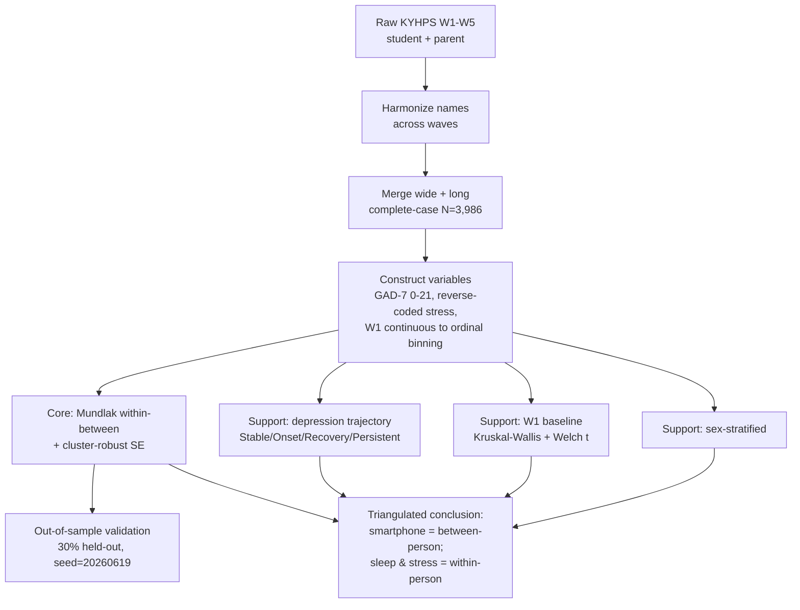

# KYHPS Longitudinal Mental Health Project - A Mundlak (Within–Between) Decomposition of Adolescent Anxiety
### A Mundlak (Within–Between) Decomposition of the Korean Youth Health Panel Survey, 2019–2023


> **One line.** Using five years of repeated measures on the same 3,986 adolescents, this project separates *who is anxious* (between-person differences) from *when the same adolescent becomes anxious* (within-person change). Smartphone use is associated with anxiety **only between persons**; **sleep and stress** carry the within-person signal.

> 🔒 **Data not included.** Raw and processed KYHPS microdata are restricted and are **not** redistributed in this repository. This repo holds code, documentation, figures, and result tables only. See [`data/README.md`](data/README.md).

---

## Contents
[Overview](#project-overview) · [Research Question](#research-question) · [Dataset](#dataset) · [Variables](#variables) · [Methodology](#methodology) · [Statistical Models](#statistical-models) · [Key Findings](#key-findings) · [Main Results](#main-results) · [Figures](#figures) · [Robustness](#robustness-checks) · [My Contributions](#my-contributions) · [Limitations](#limitations) · [Future Work](#future-work) · [Repository Structure](#repository-structure) · [Reproducibility](#reproducibility) · [References](#references)

---

## Project Overview

Public-health surveillance of adolescent mental health is largely **cross-sectional**: it measures different students each year and cannot tell whether *the same* student's anxiety worsens or recovers over time. This project re-analyzes the **Korean Youth Health Panel Survey (KYHPS)**, which follows the *same* adolescents across five annual waves (W1–W5, 2019–2023), to ask a question cross-sectional data cannot answer:

> Is the smartphone–anxiety association a **between-person** fact ("heavier users are more anxious students") or a **within-person** fact ("the same student becomes more anxious in heavier-use periods")?

The core analysis is a **Mundlak within–between decomposition** with person-clustered robust standard errors. Three supporting analyses — baseline group comparison, depression-trajectory classification, and sex-stratified description — test whether the decomposition's conclusion reproduces from different angles. Conducted for the **1st KYHPS Data Analysis Competition**; presented here as a research portfolio emphasizing longitudinal reasoning, transparent methodology, and reproducibility.

---

## Research Question

**Primary** — Does the cross-sectional smartphone–anxiety association hold *within persons* once between- and within-person variation are estimated in the same model?

**Secondary**
- Which baseline (W1) indicators distinguish adolescents who *newly develop* depression (Onset) from those who stay non-depressed (Stable)?
- During the change period (W3→W5), which variables move *together with* anxiety in the worsening (Onset) and recovering (Recovery) groups?
- How is trajectory risk distributed by sex?

---

## Dataset

| Item | Detail |
|---|---|
| Source | Korean Youth Health Panel Survey (KYHPS) |
| Waves | W1–W5, annual, **2019–2023** |
| Design | Prospective panel — same individuals repeatedly measured |
| Analytic sample | **3,986** adolescents responding in **all five** waves (complete-case panel) |
| Sex | 2,099 male / 1,887 female |
| Unit | person × wave (long) for panel models; person (wide) for trajectory grouping |

**Availability.** KYHPS microdata are restricted; this repo redistributes none of it. Scripts assume the analyst has independently obtained the data and placed it under `data/raw/`. The full processing pipeline (`src/`) is included so the workflow is auditable. Because the sample is restricted to five-wave complete responders, **panel attrition is a known source of selection bias** treated explicitly as a limitation.

---

## Variables

| Variable | Coding | Waves | Notes |
|---|---|---|---|
| **GAD-7 anxiety** (primary outcome) | 0–21 continuous; ≥10 = moderate+ | **W3–W5** | standardized to canonical 0–21 |
| **Depression** (single item) | 1 = none, 2 = experienced | W1–W5 | self-report; defines trajectory groups |
| **Weekday sleep** | 1–8 ordinal | W1–W5 | W1 continuous → binned to match W2+ |
| **Weekday smartphone use** | 1–9 ordinal | W1–W5 | W1 continuous → binned to match W2+ |
| **Stress** (5 domains) | reverse-coded, higher = more stress | W1–W5 | academic, future, friend, appearance, family |
| Sex; survey wave (year) | M / F; W1–W5 | — | covariates in the Mundlak model; sex also used as stratifier |

> **Measurement caveat carried throughout:** smartphone/sleep scales differ between W1 (continuous) and W2+ (ordinal); W1 was interval-mapped onto the ordinal scale. The GAD-7 window is **only three waves (W3–W5)**, which deliberately constrains interpretation of the within-person anxiety results.

---

## Methodology



**Why within–between separation matters (plain language).** Two facts look identical in a one-year snapshot. Fact A: students who use phones more are, on average, more anxious students. Fact B: a given student gets more anxious during the periods they use their phone more. A cross-sectional survey cannot tell these apart — but they imply different policies (screen high-risk students vs. monitor a worsening student). Panel data estimate both in one model: the **between** coefficient captures Fact A, the **within** coefficient captures Fact B.

---

## Statistical Models

**1. Mundlak (within–between) decomposition — core.** Each time-varying covariate `x_it` is split into a person mean (between) and a within-person deviation, both entered for GAD-7:

```
GAD7_it = β0 + β_within·(x_it − x̄_i) + β_between·x̄_i + ε_it
```

Estimated as a linear/OLS panel model with **person (pid) cluster-robust SE**, including **sex and survey wave (year)** as covariates. `β_between` = "which adolescents are more anxious?"; `β_within` = "when is the same adolescent more anxious?" A 30% held-out split (seed 20260619) compares predictive R² of between-only vs. within+between.

**2. Depression-trajectory classification — supporting.** W1 and W5 depression status define four groups:

| Group | W1 | W5 |
|---|---|---|
| Stable | non-dep. | non-dep. |
| Onset | non-dep. | dep. |
| Recovery | dep. | non-dep. |
| Persistent | dep. | dep. |

**3. Baseline & change — supporting.** 4-group omnibus: Kruskal–Wallis. Targeted Onset vs. Stable: Welch t. W3→W5 change inspected per group.

**4. Sex-stratified — supporting.** Sex × trajectory via χ².

All in **Python 3.11** (pandas, numpy, scipy, statsmodels, linearmodels); two-sided α = 0.05.

---

## Key Findings

> Reported as **associations within an observational panel**, not causal effects. Within coefficients are **contemporaneous** (same-wave) and do not establish temporal precedence.

1. **Smartphone use is a between-person, not within-person, correlate of anxiety (within the GAD-7 window).** Between β = **+0.113** (p = .002); within β = **+0.023** (p = .454, n.s.).
2. **Sleep and stress carry the within-person signal.** Both significant between *and* within; largest within coefficients for **stress** (family β = +0.607, friend β = +0.571).
3. **Within-person information improves out-of-sample prediction.** Held-out test R² **0.125 → 0.206**.
4. **The reading is window-bound.** Over the longer depression window (W1–W5), the smartphone **within** effect *was* significant → the anxiety within-null is specific to the short 3-wave GAD-7 window, **not** proof of no effect.
5. **What precedes new-onset depression is sleep and stress, not smartphone use.** Onset vs. Stable at W1: shorter sleep (p = .005), higher academic/future/appearance stress (p < .001), **no** smartphone difference (p = .086, n.s.).
6. **Recovery is common.** Of **692** adolescents depressed at W1, **476 (68.8%)** were non-depressed by W5; W5 GAD-7 in Recovery returned near Stable. Moderate+ anxiety (GAD-7 ≥ 10) ≈ 24% in Onset/Persistent vs. ≈ 4% in Stable/Recovery.
7. **Risk concentrates in female students (a between-person distribution).** Female share rose with severity (Stable **43.9%** → Persistent **69.0%**, p < .001); W1-non-depressed→depressed transition higher for females (17.6% vs. 13.1%).

---

## Main Results

**Table 1. Mean W1 baseline by trajectory (N = 3,986).** Stress reverse-coded († higher = more stress). p = Kruskal–Wallis 4-group omnibus.

| W1 baseline | Stable | Onset | Recovery | Persistent | p |
|---|---:|---:|---:|---:|---:|
| Sleep hours (1–8) | 6.08 | 5.90 | 5.79 | 5.70 | <.001 |
| Smartphone use (1–9) | 4.15 | 4.31 | 4.62 | 4.61 | <.001 |
| Academic stress† | 1.96 | 2.13 | 2.56 | 2.46 | <.001 |
| Future stress† | 1.68 | 1.86 | 2.21 | 2.29 | <.001 |
| Appearance stress† | 1.54 | 1.68 | 2.09 | 2.23 | <.001 |

*Key contrast:* the smartphone omnibus difference is driven by **Recovery/Persistent** (4.62/4.61) — groups already depressed at W1 — i.e., a **between-person** correlate of being depressed, **not** an onset-predictive difference. Onset and Stable did **not** differ on W1 smartphone use (Welch p = .086), whereas Onset already showed shorter sleep and higher academic/future/appearance stress.

**Table 2. Trajectory group sizes.**

| Group | N | % |
|---|---:|---:|
| Stable | 2,795 | 70.1 |
| Onset | 499 | 12.5 |
| Recovery | 476 | 11.9 |
| Persistent | 216 | 5.4 |

**Mundlak coefficients (GAD-7, W3–W5), selected.** Full output: [`results/tables/dep_v2_mundlak_gad7.xlsx`](results/tables/dep_v2_mundlak_gad7.xlsx).

| Covariate | Within β (p) | Between β (p) |
|---|---|---|
| Smartphone use | +0.023 (.454, n.s.) | +0.113 (.002) |
| Family stress | +0.607 (sig.) | sig. |
| Friend stress | +0.571 (sig.) | sig. |
| Sleep | sig. | sig. |

*Held-out (30%) test R²: between-only 0.125 → within+between 0.206 ([`dep_v2_oos.xlsx`](results/tables/dep_v2_oos.xlsx)).*

---

## Figures

| File | Shows |
|---|---|
| [`figures/Figure1_within_between.png`](figures/Figure1_within_between.png) | (A) per-variable within (●) vs. between (■) Mundlak coefficients w/ 95% CI — smartphone significant **between only**; (B) smartphone within/between ratio across outcomes |
| [`figures/Figure2_trajectories.png`](figures/Figure2_trajectories.png) | Five-year depression trajectories: wave-by-wave prevalence and W5 GAD-7 (mean + moderate+ share) by group |
| [`figures/Figure3_change_coupling.png`](figures/Figure3_change_coupling.png) | W3→W5 change trajectories (A GAD-7, B future stress, C family stress, D sleep). Onset: anxiety + future + family stress all rise; Recovery: anxiety and **family** stress fall (future stress rose slightly). **Future stress rose in all four groups** and **sleep fell in all four** (cohort-common trends); **family stress** is the one moving with trajectory direction |
| `figures/eda/` | selected exploratory figures (gender subgroup, key paradox, onset vs. stable trajectories) |

---

## Robustness Checks

> The manuscript reports the **out-of-sample validation** and the **outcome-window comparison**. The remaining rows are **repository-level sensitivity analyses** (committed as result tables) that go beyond the 4-page manuscript.

| Check | Tests | Takeaway | Output |
|---|---|---|---|
| Out-of-sample validation | overfitting | within info improves held-out R² | `dep_v2_oos.xlsx`, `rec_oos_validation.xlsx` |
| Outcome-window comparison | is the smartphone within-null window-specific? | yes — significant in longer depression window | `dep_v2_mundlak_dep_5wave.xlsx`, `dep_v2_mundlak_dep_w35.xlsx` |
| Measurement robustness | W1 continuous→ordinal binning sensitivity | conclusions inspected vs. harmonization choice | `rec_measurement_quality.xlsx`, `rec_rtm_audit.xlsx` |
| Missing-data handling | CCA vs. LOCF vs. MICE | sensitivity beyond complete-case | `robustness_mice_vs_cca.xlsx` |
| Model comparison | FE / RE / Hausman / logit AME | estimator sensitivity | `robustness_*.xlsx`, `panel_*_coefficients.xlsx` |
| Triangulation | does one conclusion reproduce across designs? | baseline, decomposition, change analysis all agree | — |

---

## My Contributions

> Five-author competition submission. Statements are scoped to be **interview-defensible** — each claim maps to code/output in this repo.

**Role:** Role: First Author and Lead Data Analyst (Team Submission)

| Area | Claimable on README/CV | Explainable in interview |
|---|---|---|
| Study design | reframed a cross-sectional question into a within–between panel question | why between vs. within is a *different* question; why panel data are required |
| Data engineering | built the W1–W5 harmonize → merge → tracking → clean pipeline (`src/01`–`05`) | the W1-continuous vs. W2+-ordinal scale problem and the fix; CCA vs. LOCF/MICE trade-offs |
| Modeling | implemented Mundlak decomposition with person-clustered robust SE (`scripts/depression_panel_v2.py`) | what the within/between split does and why clustered SE for repeated measures |
| Validation | added out-of-sample testing and the outcome-window robustness comparison | why I treat the smartphone within-null as window-bound, not "no effect" |
| Communication | produced final figures and wrote the manuscript | the triangulation argument and the limitations |

**Honest scope boundaries:** no result is called causal; within coefficients are contemporaneous associations; I describe my role as lead analyst of a team submission, not sole author of every component; the smartphone within-null is not presented as proven absence of effect.

---

## Limitations

1. **Selection / attrition** — only five-wave complete responders (N = 3,986); if dropouts were more vulnerable, associations may be conservative.
2. **Short anxiety window** — GAD-7 only at W3–W5 narrows the within-person span.
3. **Self-report depression** — trajectory grouping dichotomizes a single self-report item, not a clinical diagnosis (though it tracks GAD-7).
4. **Contemporaneous within estimates** — same-wave associations; do not establish that ΔX precedes ΔY, and shared age/period trends (sleep declines in all groups) may contaminate the within sleep–anxiety link.
5. **Single cohort; no survey weights in the core model** — design-based inference and broad generalization are not claimed.
6. **Scale harmonization** — W1 smartphone/sleep binned from continuous, limiting clean W1→W2 change interpretation.

---

## Future Work

Lagged / cross-lagged (RI-CLPM) models for temporal ordering · longitudinal mediation of stress between sleep and anxiety · attrition modeling (IPW/FIML) to relax complete-case · survey-design–based inference with KYHPS weights/strata/clusters · sex-stratified Mundlak models.

---

## Repository Structure

```
KYHPS_GitHub/
├── README.md
├── LICENSE                     # MIT 라이선스(코드) / 원자료 비공개
├── requirements.txt
├── .gitignore
├── manuscript/
│   └── kyphs-anxiety-dynamics.pdf   # 공모전 제출 원고
├── figures/
│   ├── Figure1_within_between.png
│   ├── Figure2_trajectories.png
│   ├── Figure3_change_coupling.png
│   └── eda/                    # 탐색적 분석 그림
├── scripts/                    # 분석 및 그림 생성 코드 (one ≈ one result)
│   ├── depression_panel_v2.py  # Mundlak 개인 간·개인 내 효과 분해 (핵심 분석)
│   ├── dep_v2_robustness.py
│   ├── recovery_redesign.py
│   ├── onset_analysis.py
│   ├── panel_ols.py
│   ├── robustness_check.py
│   ├── figure3_final.py / figure3_change_coupling.py
│   ├── eda_pipeline.py
│   └── utils.py
├── results/
│   └── tables/                 # 분석 결과 (dep_v2_*, rec_*, robustness_*, panel_*, ...)
├── src/                        # 분석 파이프라인 (00_config–08_visualization)
├── notebooks/                  # 탐색적 분석 노트북 (EXP002–004)
├── docs/
│   ├── codebook/               # codelist_*.csv, variable_map_*.yaml
│   ├── methods/                # 연구 노트, 가설 및 해석 기록
│   └── reproduce.md            # 재현 가이드
└── data/
    └── README.md               # 🔒 제한자료(미포함)
```

---

## Reproducibility

```bash
python -m venv .venv && source .venv/bin/activate   # Python 3.11
pip install -r requirements.txt

# Place restricted KYHPS files under data/raw/ (not distributed here), then:
python scripts/depression_panel_v2.py    # core Mundlak model -> results/tables/dep_v2_*.xlsx
python scripts/onset_analysis.py
python scripts/recovery_redesign.py
python scripts/figure3_final.py
```

All train/test splits use seed **20260619**. Full step-by-step DAG: [`docs/reproduce.md`](docs/reproduce.md).

---

## References

1. Mundlak Y. On the pooling of time series and cross section data. *Econometrica.* 1978;46(1):69–85.
2. Orben A, Przybylski AK. The association between adolescent well-being and digital technology use. *Nat Hum Behav.* 2019;3(2):173–182.
3. Spitzer RL, Kroenke K, Williams JBW, Löwe B. A brief measure for assessing generalized anxiety disorder: the GAD-7. *Arch Intern Med.* 2006;166(10):1092–1097.
4. 조수경, 이소연. 청소년의 수면시간 변화궤적과 관련 요인. *한국청소년연구.* 2020;31(1):5–32.
5. 유창민. 한국 청소년의 수면시간 변화 유형 분류 및 예측요인 확인: 잠재계층성장분석을 적용한 7개년도 종단연구. *보건사회연구.* 2019;39(1):230–258.

---

*Korean Youth Health Panel Survey (KYHPS), 1st KYHPS Data Analysis Competition. Code released under MIT; raw data restricted and not redistributed. Contact: jiwooo411@gachon.ac.kr*
